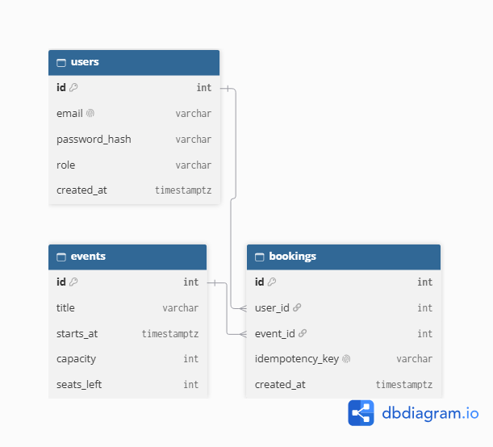

# Booking API

An API for booking seats at events. Admins create events with a fixed
number of seats, and users book them. The API never sells more seats
than exist, even when many people book at the same time.

## Endpoints

| Method | Path | Who can use it | What it does | Success | Possible errors |
|---|---|---|---|---|---|
| POST | /v1/auth/signup | Anyone | Create an account | 201 | 409 email already used, 422 invalid data |
| POST | /v1/auth/login | Anyone | Log in and get a token | 200 | 401 wrong email/password, 429 too many tries |
| GET | /v1/events | Anyone | List events, 20 per page | 200 | |
| GET | /v1/events/{id} | Anyone | See one event | 200 | 404 not found |
| POST | /v1/events | Admin | Create an event | 201 | 401 not logged in, 403 not admin, 422 invalid |
| POST | /v1/bookings | Logged-in user | Book a seat | 201 | 404 no event, 409 sold out or already booked |
| GET | /v1/bookings/me | Logged-in user | See my bookings | 200 | 401 not logged in |
| DELETE | /v1/bookings/{id} | Owner of the booking | Cancel my booking | 204 | 404 not found |

## Examples

### Sign up
Request:
```json
POST /v1/auth/signup
{ "email": "ana@example.com", "password": "password123" }
```
Response `201`:
```json
{ "id": 1, "email": "ana@example.com", "role": "user" }
```

### Log in
Request (form data, not JSON):
```
POST /v1/auth/login
username=ana@example.com&password=password123
```
Response `200`:
```json
{ "access_token": "eyJhbGciOi...", "token_type": "bearer" }
```

### List events
Request:
```
GET /v1/events?limit=2
```
Response `200`:
```json
{
  "data": [
    { "id": 1, "title": "Python 101", "starts_at": "2026-12-01T18:00:00Z", "capacity": 10, "seats_left": 4 },
    { "id": 2, "title": "SQL Night", "starts_at": "2026-12-05T18:00:00Z", "capacity": 5, "seats_left": 0 }
  ],
  "next_cursor": 2
}
```

### Get one event
Request: `GET /v1/events/1`
Response `200`:
```json
{ "id": 1, "title": "Python 101", "starts_at": "2026-12-01T18:00:00Z", "capacity": 10, "seats_left": 4 }
```

### Create an event (admin)
Request (header `Authorization: Bearer <token>`):
```json
POST /v1/events
{ "title": "Docker Day", "starts_at": "2026-12-10T09:00:00Z", "capacity": 20 }
```
Response `201`:
```json
{ "id": 3, "title": "Docker Day", "starts_at": "2026-12-10T09:00:00Z", "capacity": 20, "seats_left": 20 }
```

### Book a seat
Request (header `Authorization: Bearer <token>`, optional `Idempotency-Key: abc-123`):
```json
POST /v1/bookings
{ "event_id": 1 }
```
Response `201`:
```json
{ "id": 17, "event_id": 1, "created_at": "2026-11-20T10:00:00Z" }
```
Response `409` when there are no seats:
```json
{ "detail": "Sold out" }
```

### My bookings
Request: `GET /v1/bookings/me` (with token)
Response `200`:
```json
[ { "id": 17, "event_id": 1, "created_at": "2026-11-20T10:00:00Z" } ]
```

### Cancel a booking
Request: `DELETE /v1/bookings/17` (with token)
Response `204`: no body. The seat goes back to the event.

## Data model

```text
users     id PK · email UNIQUE · password_hash · role ('user' | 'admin') · created_at
events    id PK · title · starts_at · capacity · seats_left CHECK (seats_left >= 0)
bookings  id PK · user_id FK → users · event_id FK → events
          idempotency_key UNIQUE (nullable) · created_at
          UNIQUE (user_id, event_id)   -- one booking per user per event
```

- `seats_left >= 0`: the database refuses overselling even if the code has a bug.
- `UNIQUE (user_id, event_id)`: a user can't book the same event twice.
- `idempotency_key UNIQUE`: a retried request can't create a second booking.
- `seats_left` is stored on the event so it can be decreased in one atomic step.

